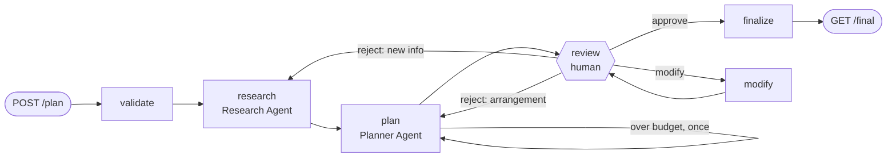

# AI Travel Planner

A multi-agent trip planner built with **LangGraph** and **FastAPI**. A research agent gathers live destination information, an itinerary agent builds a timed day-by-day plan, and the workflow **pauses for human review** (approve, reject with feedback, or modify specific days) before producing the final plan. State is checkpointed to SQLite, so a plan waiting for review survives restarts.

**Full design report:** [docs/AI_Travel_Planner_Report.pdf](docs/AI_Travel_Planner_Report.pdf). It covers the architecture in detail, the tools, the HITL flow, a live run, testing, tradeoffs, improvements, production concerns and assumptions.

## Architecture



- **Orchestrator** (`app/graph.py`): a LangGraph `StateGraph`. It routes between the agents, pauses with `interrupt()` and resumes with `Command(resume=…)`. Every node is checkpointed to SQLite.
- **Research Agent**: `web_search` (Exa) and `weather_outlook` (Open-Meteo forecast, or last year's weather on the same dates).
- **Itinerary Planner Agent**: `optimize_schedule`, which geocodes places on OpenStreetMap, groups them into days and orders each day around opening hours and travel time, and `find_restaurants`, which returns real nearby restaurants from OpenStreetMap.
- **Human review**: reject feedback is routed to the agent that should redo its work. Modify changes only the named days, which the code enforces. Approve finalizes the draft exactly as approved.

## Setup

Requires Python 3.12.

```bash
python -m venv .venv
.venv\Scripts\activate            # macOS/Linux: source .venv/bin/activate
pip install -r requirements-dev.txt
cp .env.example .env              # add GOOGLE_API_KEY and EXA_API_KEY
```

| Variable | Required | Notes |
|---|---|---|
| `GOOGLE_API_KEY` | yes | [Google AI Studio](https://aistudio.google.com/apikey) (free tier works) |
| `EXA_API_KEY` | yes | [Exa dashboard](https://dashboard.exa.ai/api-keys) |
| `GEMINI_MODEL`, `GEMINI_FALLBACK_MODELS` | no | primary model and fallbacks for 503/429 errors; defaults in `.env.example` |

## Run

```bash
uvicorn app.main:app --reload       # interactive docs at http://localhost:8000/docs
pytest                              # 44 offline tests, no keys needed
```

Docker: `docker build -t travel-planner .` then `docker run -p 8000:8000 --env-file .env -v planner-data:/app/data travel-planner`. The Dockerfile has not been test-built.

## API

| Method | Endpoint | Purpose |
|---|---|---|
| POST | `/plan` | Submit a request → `202` with `plan_id` (`422` on invalid input) |
| GET | `/plan/{id}` | Status, current draft, research, review history (`404` if unknown) |
| POST | `/plan/{id}/review` | `approve`, `reject` + `feedback`, or `modify` + `modifications` (`409` if not awaiting review) |
| GET | `/plan/{id}/final` | The approved plan (`409` before approval) |
| GET | `/plan/{id}/events` | Server-sent events stream of status changes |
| POST | `/plan/{id}/retry` | Resume a failed run from its last checkpoint |

Work runs in the background, so POSTs return `202` immediately, and clients poll `GET /plan/{id}` or listen on `/events`.

### Example (from a live run, trimmed)

```bash
curl -X POST localhost:8000/plan -H "Content-Type: application/json" -d '{
  "destination": "Lisbon, Portugal", "start_date": "2026-11-20", "end_date": "2026-11-22",
  "budget_min": 900, "budget_max": 1600, "currency": "EUR", "travelers": 2,
  "interests": ["food", "history", "viewpoints"], "notes": "Relaxed pace; one of us is vegetarian."}'
```
```json
{"plan_id": "3f2a…", "status": "queued", "links": {"status": "/plan/3f2a…", "review": "/plan/3f2a…/review", "final": "/plan/3f2a…/final", "events": "/plan/3f2a…/events"}}
```

`GET /plan/3f2a…` once the draft is ready:
```json
{
  "status": "awaiting_review",
  "revision": 1,
  "allowed_actions": ["approve", "reject", "modify"],
  "draft": {
    "title": "Lisbon Autumn Weekend: History, Viewpoints & Culinary Flavors",
    "lodging": {"name": "Boutique Hotel in Chiado", "area": "Chiado", "cost_per_night": 180.0},
    "days": [{"day": 1, "date": "2026-11-20", "theme": "Panoramic Viewpoints, Moorish Fortress & Historic Baixa",
              "activities": [{"start": "09:43", "end": "10:43", "name": "Miradouro da Senhora do Monte",
                              "cost_per_person": 0.0, "travel_minutes_from_previous": 13, "…": "…"}, "…"],
              "meals": [{"meal": "breakfast", "name": "Pastelaria Bénard", "…": "…"}, "…"]}, "…"],
    "budget": {"currency": "EUR", "lodging": 360.0, "activities": 138.0, "meals": 354.0,
               "local_transport": 45.0, "total": 897.0, "status": "under"}
  },
  "research": "{…}", "reviews": [], "events": ["…"]
}
```

Review it with `POST /plan/3f2a…/review`. Each call returns `202`, and the plan returns to `awaiting_review` with a new revision:
```json
{"action": "reject", "feedback": "Too much time on public transport. Keep each day in one area and add a fado evening."}
{"action": "modify", "modifications": [{"day": 2, "change": "Replace the afternoon with a sunset at a viewpoint and a vegetarian dinner nearby."}]}
{"action": "approve"}
```
In this run, the reject was routed to the research agent (`"routed_to": "research"`). After approval, `GET /plan/3f2a…/final` returns `200` with `approved_revision`, the `itinerary`, a `destination_brief` (weather, tips, safety, sources) and the `review_history`.

## Design decisions and tradeoffs

- **Asynchronous API (202 + polling or SSE).** Runs take minutes, so requests never block on the LLM.
- **The checkpoint is the single source of truth.** Status, drafts, reviews and errors come from LangGraph state, so restart recovery and retry need no extra bookkeeping.
- **Typed agent outputs and deterministic code where correctness matters.** Agents return Pydantic objects. Budget totals, the modify guard and the final plan are plain Python, not LLM output.
- **Resilience on a free tier.** A model fallback chain, per-tool call limits, and API fallbacks for OpenStreetMap all exist because live testing hit 503s, quota limits and runaway tool use.
- **Free, keyless data for 3 of 4 tools.** The project runs with two API keys. The cost is that travel times are estimates, not real routing.
- **Single process.** This is correct for one worker. Scaling needs a job queue and Postgres; see the report.
