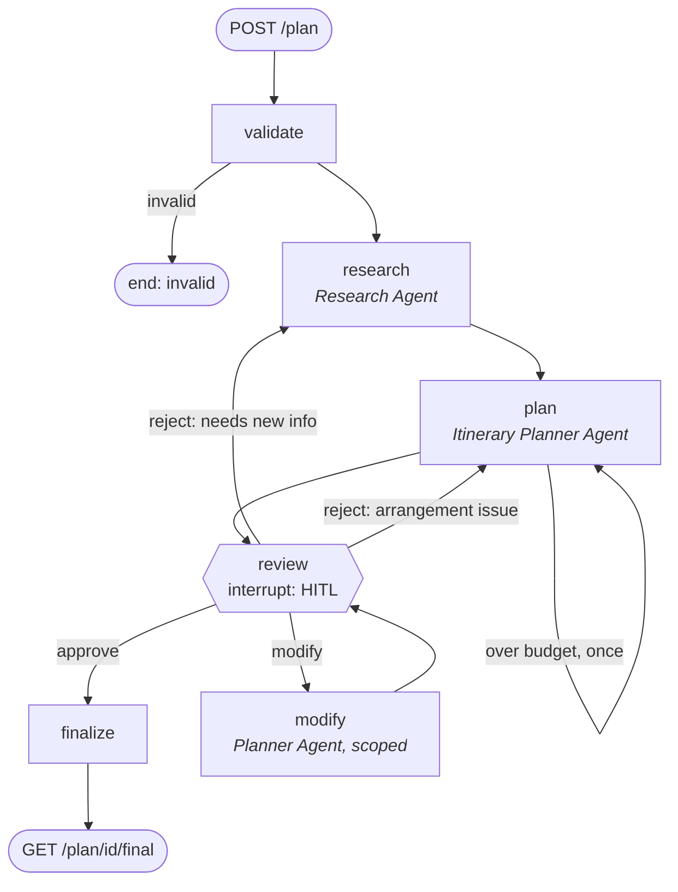

# AI Travel Planner

A multi-agent trip planner built on **LangGraph** and served by **FastAPI**. A user submits a destination, dates, budget, interests and group size. A research agent gathers live destination intelligence, an itinerary agent turns it into a timed day-by-day plan, and the workflow **pauses for human review** (approve, reject with feedback, or modify specific days) before producing the final plan. Workflow state is checkpointed to SQLite, so a plan waiting for review survives server restarts.

- **LLM:** Google Gemini (free tier works; model set by `GEMINI_MODEL`)
- **Web search:** Exa API
- **Other tools:** Open-Meteo (weather), OpenStreetMap Nominatim + Overpass (geocoding, restaurants). These are free and need no key.

---

## Architecture



| Component | What it does | Tools |
|---|---|---|
| **Orchestrator** (`app/graph.py`) | `StateGraph` that validates the request, routes between agents, enforces the budget, pauses at `review` with `interrupt()`, resumes with `Command(resume=…)`, and assembles the final plan | — |
| **Research Agent** (`app/agents.py`) | Tool-calling agent that returns a typed `ResearchReport`: attractions with durations, prices and hours, neighbourhoods, tips, safety, seasonal notes, typical costs, sources | `web_search` (Exa, mandatory), `weather_outlook` (Open-Meteo) |
| **Itinerary Planner Agent** (`app/agents.py`) | Tool-calling agent that returns a typed `Itinerary`: lodging, one entry per day with timed activities, travel minutes and real restaurants | `optimize_schedule`, `find_restaurants` |
| **Feedback router** | Small LLM call that decides whether a rejection needs new research or only re-planning (skipped if the reviewer sets `revise`) | — |
| **Runner** (`app/runner.py`) | Runs graph executions as background asyncio tasks and derives each plan's status from its checkpoint | — |
| **API** (`app/main.py`) | FastAPI endpoints, validation, status codes, server-sent events | — |

### The four tools

| Tool | Agent | How it works |
|---|---|---|
| `web_search` | Research | Exa `/search` with highlights. Returns title, URL, date and the relevant passages for each of the top 5 results. |
| `weather_outlook` | Research | Open-Meteo. Trips within the 16-day window get a **real forecast**; later trips get **last year's observed weather on the same dates**, a better guide than a monthly average. |
| `optimize_schedule` | Planner | A **scheduling optimiser**. It geocodes each candidate place on OpenStreetMap (inside the city's bounding box first), clusters places into days with k-means, moves stops out of over-full days into the nearest day with room, then orders each day to respect **opening hours** and minimise travel. Days with up to 6 stops are searched exhaustively; larger days use nearest neighbour plus 2-opt. It outputs a timed schedule with walk/transit/drive legs and lists places that did not fit (`unscheduled`) or could not be found (`unlocated`). |
| `find_restaurants` | Planner | **Real restaurants** near a place from OpenStreetMap (Overpass radius query), nearest first, with cuisine, opening hours, address and website, plus cuisine and vegetarian filters. Public Overpass servers are often overloaded, so the tool retries with backoff, tries a mirror, then falls back to Nominatim's restaurant search. |

### Human-in-the-loop and persistence

- The `review` node calls `interrupt()`. LangGraph checkpoints the state, and the run ends with the plan in `awaiting_review`.
- `POST /plan/{id}/review` resumes the same thread (`thread_id = plan_id`) with `Command(resume=<review body>)`. The node re-runs, receives the decision and returns a `Command(goto=…)`:
  - **approve** → `finalize`. This step is deterministic (no LLM), so the final plan is exactly the approved draft plus context.
  - **reject** + feedback → `research` or `plan`. The reviewer can choose with `"revise": "research" | "itinerary"`; otherwise an LLM router decides, falling back to the planner if that call fails. The agent receives the previous draft and the feedback.
  - **modify** + `[{day, change}]` → `modify`. The planner applies only those changes, then the code **restores every day that was not named**, plus the lodging and texts. LLM edits therefore cannot leak into parts the reviewer did not touch. A change without a `day` (for example "cheaper hotel") is plan-wide and accepts the new draft as returned.
- The checkpointer is `AsyncSqliteSaver` (`data/checkpoints.sqlite`). Runs use `durability="sync"`, so every node boundary is on disk before the next node starts. As a result:
  - a plan awaiting review can be reviewed after a restart (tested);
  - a failed step (for example an LLM quota error) is stored with its error, and `POST /plan/{id}/retry` resumes from the last checkpoint without repeating earlier steps (tested);
  - runs interrupted by a shutdown are found and resumed on startup (`Runner.recover`).
- **Status is derived from the checkpoint**, so there is no separate status table to drift out of sync:

| status | meaning | allowed actions |
|---|---|---|
| `queued` | accepted, first checkpoint not written yet | — |
| `validating` / `researching` / `planning` / `modifying` / `finalizing` | that node is running | — |
| `awaiting_review` | paused at the interrupt with a draft | `approve`, `reject`, `modify` (only `approve` after `MAX_REVISIONS` rounds) |
| `processing` | a review or retry was just accepted | — |
| `completed` | approved; `/final` is available | — |
| `failed` | a step raised; `error` says why | `retry` |
| `stalled` | the process stopped mid-run (normally resumed automatically on startup) | `retry` |
| `invalid` | the orchestrator rejected the request | — |

### Budget handling

Agents estimate per-item costs: activities and meals per person, lodging per night for the group. **Totals are computed in code** (`estimate_budget`): lodging × nights + (activities + meals + local transport) × travellers. If a fresh draft exceeds `budget_max`, the orchestrator sends it back to the planner **once** with the overage before the human sees it. Every draft carries a `budget` block with a breakdown and an `over`, `within` or `under` status.

---

## Setup

Requires Python 3.12.

```bash
python -m venv .venv
.venv\Scripts\activate            # Windows  (macOS/Linux: source .venv/bin/activate)
pip install -r requirements-dev.txt
cp .env.example .env              # then fill in the two keys
```

`.env`:

| Variable | Required | Notes |
|---|---|---|
| `GOOGLE_API_KEY` | yes | https://aistudio.google.com/apikey (free tier works) |
| `EXA_API_KEY` | yes | https://dashboard.exa.ai/api-keys (free credits on signup) |
| `GEMINI_MODEL` | no | default `gemini-3.5-flash` |
| `GEMINI_FALLBACK_MODELS` | no | comma-separated, tried in order when the primary returns 503/429; default `gemini-3.6-flash,gemini-3.5-flash,gemini-3.5-flash-lite,gemini-3.1-flash-lite` |
| `DB_PATH` | no | default `data/checkpoints.sqlite` |
| `MAX_REVISIONS` | no | reject/modify rounds per plan, default 5 |

## Run

```bash
uvicorn app.main:app --reload
```

Interactive docs: http://localhost:8000/docs

With Docker:

```bash
docker build -t travel-planner .
docker run -p 8000:8000 --env-file .env -v planner-data:/app/data travel-planner
```

(The Dockerfile was not built during development because Docker was not installed on the development machine; the local `uvicorn` path is the tested one.)

## Tests

```bash
pytest                      # 44 offline tests: tools, orchestrator, runner, agent wiring, API (no keys needed)
RUN_LIVE=1 pytest -m live   # smoke tests against the real Open-Meteo / OSM / Exa APIs
```

The offline suite covers every HITL path, the budget loop, restart persistence, failure and retry, status codes, server-sent events, and the tool logic (scheduler, weather, restaurant fallback, search, budget).

---

## API

| Method | Endpoint | Purpose | Success | Errors |
|---|---|---|---|---|
| POST | `/plan` | Submit a travel request, start the workflow | `202` + `plan_id` | `422` invalid body (dates reversed or in the past, >14 days, budget_min > budget_max, no interests, bad currency) |
| GET | `/plan/{id}` | Status, current draft, research, review history, progress events | `200` | `404` |
| POST | `/plan/{id}/review` | HITL decision: `approve`, `reject` (+`feedback`, optional `revise`), `modify` (+`modifications`) | `202` | `404`; `409` not awaiting review or revision limit reached; `422` missing feedback/modifications or unknown day |
| GET | `/plan/{id}/final` | The approved plan | `200` | `404`; `409` not approved yet |
| GET | `/plan/{id}/events` | Server-sent events stream of status changes | `200` `text/event-stream` | `404` |
| POST | `/plan/{id}/retry` | Resume a failed or stalled run from its last checkpoint | `202` | `404`; `409` not failed |
| GET | `/health` | Liveness and which keys are configured | `200` | — |

All POSTs return immediately: the agents take a minute or more, so work runs in the background, and clients poll `GET /plan/{id}` or listen on `/events`.

### Example session

Real output from one live run (Lisbon, 3 days, 2 travellers), trimmed. Events, activities and meals are flattened to one line each here. The API returns them as objects: events as `{at, message}`; activities with `start`, `end`, `name`, `description`, `area`, `cost_per_person` and `travel_minutes_from_previous`. Drafts 2-3 came from `gemini-3.5-flash-lite` after the free-tier quota for the full Flash models ran out (it over-applied the fado request to every night).

**1. Submit** — `POST /plan` → `202`

```bash
curl -X POST localhost:8000/plan -H "Content-Type: application/json" -d '{"destination": "Lisbon, Portugal", "start_date": "2026-11-20", "end_date": "2026-11-22", "budget_min": 900, "budget_max": 1600, "currency": "EUR", "travelers": 2, "interests": ["food", "history", "viewpoints"], "notes": "Relaxed pace; one of us is vegetarian."}'
```
```json
{"plan_id": "3f2a…", "status": "queued", "links": {"status": "/plan/3f2a…", "events": "/plan/3f2a…/events", "review": "/plan/3f2a…/review", "final": "/plan/3f2a…/final"}}
```

**2. Draft ready** — `GET /plan/{id}` → `200` (day 1 shown)
```json
{
  "status": "awaiting_review",
  "revision": 1,
  "allowed_actions": [
    "approve",
    "reject",
    "modify"
  ],
  "events": [
    "Request validated: 3 days in Lisbon, Portugal for 2",
    "Research agent: 10 attractions, 9 sources (weather_outlook x1, web_search x6)",
    "Planner agent: draft 1, estimated 897.0 EUR (under budget; optimize_schedule x1, find_restaurants x5)"
  ],
  "draft": {
    "title": "Lisbon Autumn Weekend: History, Viewpoints & Culinary Flavors",
    "lodging": {
      "name": "Boutique Hotel in Chiado",
      "area": "Chiado",
      "cost_per_night": 180.0
    },
    "days": [
      {
        "day": 1,
        "date": "2026-11-20",
        "theme": "Panoramic Viewpoints, Moorish Fortress & Historic Baixa",
        "activities": [
          "09:43-10:43 Miradouro da Senhora do Monte (0 EUR pp, 13 min travel)",
          "10:53-12:53 Castelo de São Jorge (17 EUR pp, 10 min travel)",
          "13:00-14:00 Miradouro de Santa Luzia (0 EUR pp, 7 min travel)",
          "…"
        ],
        "meals": [
          "breakfast: Pastelaria Bénard (Portuguese Bakery & Cafe)",
          "lunch: Casa da Tia Helena (Traditional Petiscos & Local Fare)",
          "dinner: Mezzogiorno (Italian & Vegetarian-Friendly)"
        ]
      },
      "… days 2-3"
    ],
    "budget": {
      "currency": "EUR",
      "lodging": 360.0,
      "activities": 138.0,
      "meals": 354.0,
      "local_transport": 45.0,
      "total": 897.0,
      "budget_min": 900.0,
      "budget_max": 1600.0,
      "status": "under"
    }
  }
}
```

`GET /plan/{id}/final` at this point → `409 {"detail": {"message": "the final plan is only available after approval", "status": "awaiting_review", ...}}`

**3. Reject** — `POST /plan/{id}/review` → `202`
```json
{"action": "reject", "feedback": "Too much time on public transport. Keep each day in one area and add a fado evening."}
```
The router sent it to the research agent, and the planner rebuilt the plan. `GET /plan/{id}`:
```json
{
  "status": "awaiting_review",
  "revision": 2,
  "reviews": [
    {
      "action": "reject",
      "routed_to": "research",
      "routing_reason": "The feedback requests adding a fado evening, which introduces a new cultural interest and event type requiring new destination options and information."
    }
  ],
  "draft": {
    "days": [
      {
        "day": 1,
        "theme": "Historic Alfama, Moorish Castle & Authentic Fado Evening"
      },
      {
        "day": 2,
        "theme": "Fado Heritage, Baixa Architecture & Second Fado Night"
      },
      {
        "day": 3,
        "theme": "Garden Terraces & Intimate Chapel Fado Finale"
      }
    ],
    "budget": {
      "total": 1417.0,
      "status": "within"
    }
  }
}
```

**4. Modify one day** — `POST /plan/{id}/review` → `202`
```json
{"action": "modify", "modifications": [{"day": 2, "change": "Replace the afternoon with a sunset at a viewpoint and a vegetarian dinner nearby."}]}
```
Only day 2 changed; days 1 and 3 and the lodging are byte-identical to revision 2, enforced in code.
```json
{
  "revision": 3,
  "draft": {
    "days": [
      "day 1: unchanged",
      {
        "day": 2,
        "theme": "Fado Heritage, Sunset Viewpoint & Vegetarian-Friendly Dinner",
        "activities": [
          "10:30-12:00 Museu do Fado (5 EUR pp, 10 min travel)",
          "16:30-18:00 Miradouro de Santa Luzia (0 EUR pp, 10 min travel)",
          "19:00-21:00 A Muralha Tasca Tipica (25 EUR pp, 10 min travel)"
        ],
        "meals": [
          "breakfast: The Hideout - Brunch Restaurant (Bakery & Coffee)",
          "lunch: O Galhardo (Portuguese Petiscos)",
          "dinner: A Muralha Tasca Tipica (Portuguese)"
        ]
      },
      "day 3: unchanged"
    ],
    "budget": {
      "total": 1221.0,
      "status": "within"
    }
  }
}
```

**5. Approve** — `POST /plan/{id}/review` with `{"action": "approve"}` → `202`, then `GET /plan/{id}/final` → `200`
```json
{
  "plan_id": "3f2a…",
  "approved_at": "2026-10-22T18:08:03+00:00",
  "approved_revision": 3,
  "request": "{{…}}",
  "itinerary": "{{… revision 3, identical to the approved draft}}",
  "destination_brief": {
    "summary": "…",
    "weather": "…",
    "neighbourhoods_to_stay": [
      "…"
    ],
    "local_tips": [
      "…"
    ],
    "safety": [
      "…"
    ],
    "seasonal_notes": [
      "…"
    ],
    "sources": [
      "https://www.clubedefado.pt/en/",
      "https://fadoaocarmo.pt/en/",
      "…"
    ]
  },
  "review_history": [
    {
      "revision": 1,
      "action": "reject",
      "routed_to": "research"
    },
    {
      "revision": 2,
      "action": "modify"
    },
    {
      "revision": 3,
      "action": "approve"
    }
  ]
}
```

**Errors**
- `POST /plan` with `end_date` before `start_date` → `422` (`"Value error, end_date must be on or after start_date"`)
- `POST /plan/{id}/review` on a completed plan → `409 {"detail": {"message": "plan is not awaiting review", "status": "completed", "allowed_actions": []}}`

**Live status** — `GET /plan/{id}/events` (server-sent events, one per change):
```text
event: status
data: {"status": "planning", "revision": 0, "allowed_actions": [], "latest": {"message": "Research agent: 10 attractions, 9 sources (weather_outlook x1, web_search x6)", ...}}
```

---

## Design decisions and tradeoffs

1. **Asynchronous API (202 + polling/SSE) instead of blocking requests.** A plan takes one to three minutes on the free tier: research is 5-7 searches, and the planner geocodes at OpenStreetMap's 1 request/second limit and makes several LLM calls. Holding HTTP connections that long is fragile. The tradeoff is that clients must poll or use SSE.
2. **The LangGraph checkpoint is the single source of truth.** Status, draft, review history and errors are all read from the checkpoint. This removes a whole class of "status table says X, graph says Y" bugs and gives retry and restart recovery almost for free. The cost is that listing plans scans checkpoints (fine here; at scale you would add an index table).
3. **Agents return Pydantic objects** (LangChain `create_agent` + `ToolStrategy`). The orchestrator never parses free text, and invalid output is retried by the agent itself.
4. **Deterministic code wherever correctness matters:** budget totals, the modify guard, the final plan and status derivation are all plain Python and unit-tested. LLMs are used only for judgement: research, planning, routing.
5. **Precise rejection routing.** Feedback such as "add an art museum" needs new research, while "too rushed" only needs re-planning. An LLM router picks the target, the reviewer can override it with `revise`, and a router failure falls back to the planner rather than failing the review.
6. **Free, keyless data sources for 3 of 4 tools** keep the project runnable for anyone with two keys. The price is accuracy: travel times are straight-line × 1.3 at a speed per mode, not real routing, and OSM restaurant coverage varies by city.
7. **Gemini free tier, made resilient.** In the live run the newest Flash models often returned `503 high demand`, and this key's free tier allowed only **20 requests per model per day**. So:
   - every agent uses LangChain's `ModelFallbackMiddleware` with a chain of models (each failing over after 2 retries, and each with its own daily quota);
   - the research agent sends its searches as parallel tool calls in one turn, which uses fewer requests and is faster;
   - when every model fails, the plan is marked `failed` with the error and `POST /retry` resumes it later from the checkpoint.
   Each agent loop is capped (`recursion_limit=40`). For real use, a paid tier removes most of this friction.
8. **Single process.** Background tasks are asyncio tasks, and a per-process lock makes "check status, then resume" atomic. That is correct for one worker; multiple workers need the changes listed under production concerns.

### Found during live testing

The offline tests use fake agents, so a few problems only appeared with the real LLMs and APIs. All are fixed, and the first has a regression test:

- **Status race.** `GET /plan/{id}` briefly reported `invalid` while research was running. Between a step's writes and its checkpoint, LangGraph's snapshot shows no next node, and the status code read that as "finished". A running plan is now never reported as terminal (`tests/test_runner.py`), and runs use synchronous durability.
- **Overloaded upstreams.** Public Overpass servers answered `502 at capacity` or timed out, which led to the retry, mirror and Nominatim fallback. Gemini models answered `503` or ran out of free quota, which led to the model fallback chain.
- **Runaway tool use.** One model kept "verifying" every attraction, one search at a time, until it hit the recursion limit. Per-tool caps (`ToolCallLimitMiddleware`) now block calls over the limit and force an answer, and the prompt asks for parallel searches.
- **A LangGraph edge case.** Giving the agents `checkpointer=False` while the parent runs with `durability="sync"` crashes inside LangGraph (`AsyncPregelLoop … _put_checkpoint_fut`). The agents therefore inherit the checkpointer, with their output types allow-listed for deserialisation. `tests/test_agent_wiring.py` now runs the real agents, with a scripted model, inside the real graph and runner to catch wiring bugs like this.
- **Recovery checked for real.** The server was killed mid-research. On restart `recover()` resumed the plan, and a later `failed` plan resumed via `/retry` without repeating research. A retried agent also continues its own conversation from its subgraph checkpoint rather than starting over.

## What I would improve with more time

- Real routing (OSRM or Google Routes) and OSM opening-hours parsing inside the optimiser, instead of hours supplied by the LLM.
- A currency tool, so prices are converted at live rates rather than estimated by the LLM.
- Stream agent tool calls (LangGraph `astream(..., subgraphs=True)`) into the SSE feed, not just node-level progress.
- Evaluation: a fixed set of trip requests scored for constraint satisfaction (budget, opening hours, day count, real places) to compare prompts and models.
- Let the reviewer edit the draft JSON directly (a deterministic patch) in addition to natural-language modifications.
- A small web UI for the review step.

## Production concerns

- **Scaling and workers:** move graph execution to a queue (Celery, Arq or LangGraph Platform) and the checkpointer to Postgres (`langgraph-checkpoint-postgres`). Use a database row lock or advisory lock instead of the in-process lock so two workers cannot resume the same thread.
- **Reliability:** idempotency keys on `POST /plan`; timeouts per node; circuit breakers and caching for external APIs (geocodes and restaurant lookups cache well); a dead-letter path for repeatedly failing plans.
- **Cost and abuse:** authentication, per-user rate limits and quotas, token and cost accounting per plan (Exa returns `costDollars`), and an upper bound on revisions (`MAX_REVISIONS`, already enforced).
- **Observability:** LangSmith or OpenTelemetry tracing of every agent step, structured logs with `plan_id`, and metrics for latency, tool error rate and approval rate.
- **Safety and data quality:** treat web content as untrusted input to the LLM (prompt injection), validate that planned places exist (the optimiser already reports `unlocated`), and keep PII out of logs. Respect OSM usage policies or self-host Nominatim and Overpass.
- **Data lifecycle:** TTL and cleanup for old checkpoints, plus backups.

## Assumptions

- The budget is the **total for the whole group** and covers lodging, food, activities and local transport, **not** flights or trains to the destination. It is in the request's `currency`; the LLM converts local prices.
- Trips are 1-14 days, start today or later, for 1-20 travellers.
- The trip starts in the morning of `start_date` and ends in the evening of `end_date`: nights = days − 1.
- "Modify" means targeted changes to named days, or plan-wide changes such as the hotel. "Reject" means the draft is not right and needs a new pass.
- Prices, opening hours and events come from web search and the LLM's reading of it, so they are estimates to check before booking.
